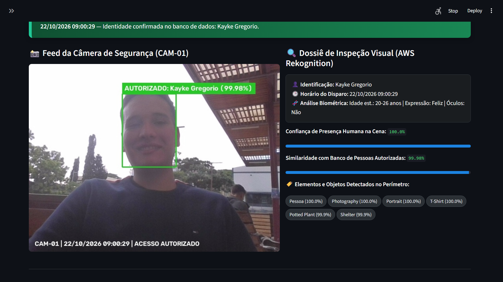
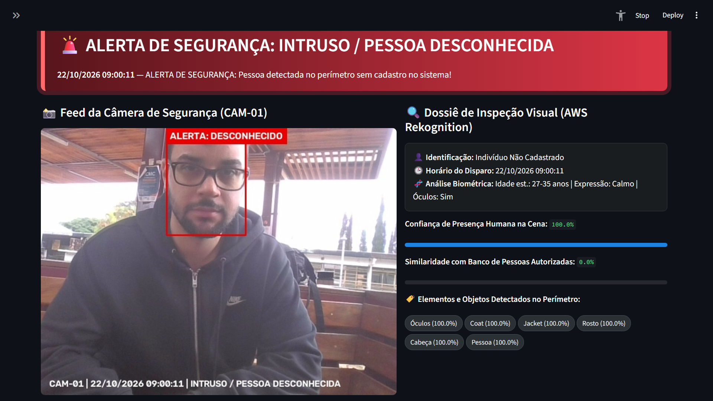
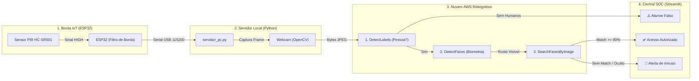

# 🛡️ Sentinela IoT — Monitoramento Perimetral com ESP32 e AWS Rekognition


Projeto desenvolvido para a disciplina de **Sensores Inteligentes**. O **Sentinela IoT** é um sistema de segurança e controle de acesso baseado em borda (ESP32 + Sensor PIR) integrado à visão computacional em nuvem (**AWS Rekognition**).

Ao contrário de câmeras convencionais que apenas gravam continuamente, o sistema atua sob demanda: detecta variações infravermelhas de movimento, captura o quadro da câmera local, verifica primeiro se há um **ser humano** na cena (descartando alarmes falsos causados por animais ou objetos) e valida a identidade biométrica contra uma coleção de pessoas autorizadas na AWS.

---

## 📸 Demonstração Visual do Projeto

> **Dica para o seu GitHub:** Crie uma pasta chamada `docs/` no seu repositório, salve os prints do seu sistema funcionando e substitua os caminhos abaixo!

| Painel em Estado Seguro (Autorizado) | Alerta Crítico (Intruso Detectado) |
| :---: | :---: |
|  |  |

| Montagem Física (ESP32 + Sensor PIR HC-SR501) |
| :---: |
|  |

---

## 🏗️ Arquitetura e Fluxo de Decisão

O GitHub renderiza automaticamente o fluxograma abaixo mostrando como os 4 módulos do projeto conversam entre si:



---

## 🧠 Inteligência em 3 Estágios (Por que usar 3 APIs da AWS?)

1. **Estágio 1 — Detecção de Presença Humana (`DetectLabels`):**
   Analisa a cena completa antes de procurar rostos. Se um invasor entrar de costas, de capuz ou longe da câmera, a AWS identifica a classe `Person` / `Human` e aciona o **Alerta Crítico de Intruso (Rosto Oculto)**. Se o sensor PIR disparar sem humanos na imagem, classifica como **Alarme Falso**.
2. **Estágio 2 — Extração de Atributos Faciais (`DetectFaces`):**
   Se houver um rosto no enquadramento, extrai estimativa de faixa etária, expressão emocional predominante e uso de óculos para compor o dossiê forense.
3. **Estágio 3 — Reconhecimento Facial (`SearchFacesByImage`):**
   Compara o vetor facial com os rostos indexados na *Collection* `trabalhosensores_faces` da AWS (limiar de confiança configurado em `80%`).

---

## 🔌 Esquema de Ligação do Hardware (ESP32 + HC-SR501)

| Pino do Sensor PIR (HC-SR501) | Pino no ESP32 | Função |
| :--- | :--- | :--- |
| **VCC** | `VIN` (5V) | Alimentação de 5V para o regulador interno do sensor |
| **OUT** | `GPIO 27` | Sinal digital de saída (3.3V em movimento) com `INPUT_PULLDOWN` |
| **GND** | `GND` | Referência comum (Terra) |

> **Ajuste Físico Recomendado:** Mantenha o potenciômetro de **Tempo (Time Delay)** do módulo HC-SR501 girado totalmente no sentido **anti-horário** para que o pulso dure ~2 segundos e permita detecção rápida de novos eventos.

---

## 📂 Estrutura de Arquivos do Repositório

```text
📦 sentinela-iot-aws
 ┣ 📂 capturas_historico/     # Galeria automática de fotos anotadas pelo OpenCV
 ┣ 📂 docs/                   # Fotos do hardware e prints para o README
 ┣ 📜 esp32_pir_serial.ino    # Firmware C++ do ESP32 (detecção de borda + cooldown)
 ┣ 📜 setup_aws.py            # Script de criação da Collection e indexação de rostos
 ┣ 📜 servidor_pc.py          # Backend Python (Leitura Serial + OpenCV + AWS Boto3)
 ┣ 📜 dashboard.py            # Interface Web SOC em Streamlit
 ┣ 📜 .gitignore              # Proteção para não subir credenciais ou fotos privadas
 ┗ 📜 README.md               # Documentação do projeto
```

---

## 🚀 Como Executar o Projeto

### 1. Pré-requisitos e Instalação
Clone o repositório e instale as dependências no seu ambiente Python:

```bash
pip install boto3 opencv-python pyserial streamlit pillow
```

### 2. Configuração de Segurança da AWS (IAM)
Crie um usuário no **AWS IAM** com a política `AmazonRekognitionFullAccess` e configure suas chaves localmente no arquivo `~/.aws/credentials`:

```ini
[default]
aws_access_key_id = SUA_ACCESS_KEY_AQUI
aws_secret_access_key = SUA_SECRET_KEY_AQUI
```

> ⚠️ **Importante:** Nunca coloque suas chaves da AWS diretamente dentro do código antes de dar `git push` para o GitHub!

### 3. Inicializar o Banco de Rostos na AWS
Adicione uma foto nítida na pasta do projeto e execute:

```bash
python setup_aws.py
```

### 4. Gravar o Firmware no ESP32
Abra o arquivo `esp32_pir_serial.ino` na Arduino IDE, selecione a placa `ESP32 Dev Module` e faça o upload. **Feche o Serial Monitor da Arduino IDE** após a gravação para liberar a porta COM.

### 5. Iniciar o Backend e a Central de Monitoramento
Em **dois terminais separados**, execute:

**Terminal 1 (Motor de Captura e IA):**
```bash
python servidor_pc.py
```

**Terminal 2 (Dashboard Web SOC):**
```bash
python -m streamlit run dashboard.py
```

---

## 🛡️ Arquivo `.gitignore` Recomendado

Antes de subir seu projeto para o GitHub, crie um arquivo chamado `.gitignore` na pasta do projeto com o conteúdo abaixo para evitar subir suas chaves ou fotos de teste pessoais por engano:

```gitignore
.env
.aws/
__pycache__/
capturas_historico/
ultima_captura.jpg
minha_foto.jpeg
status.json
historico.json
```

---

## 👨‍💻 Autor

Desenvolvido por **Kayke Gregório** — Projeto prático de Sensores Inteligentes e IoT com Inteligência Artificial em Nuvem.
`